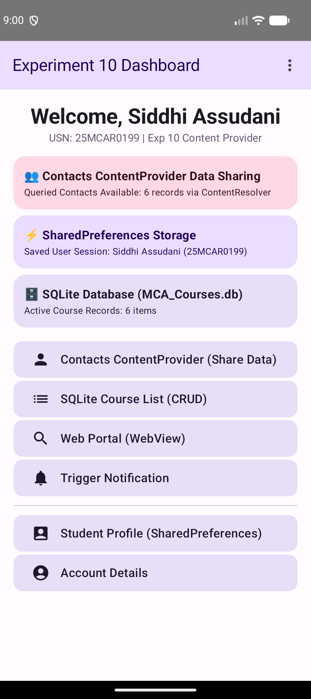
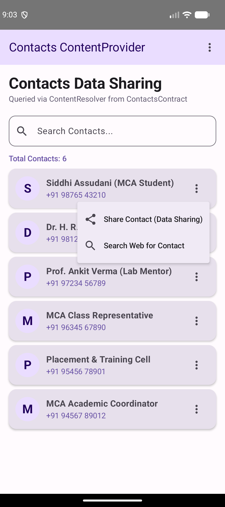
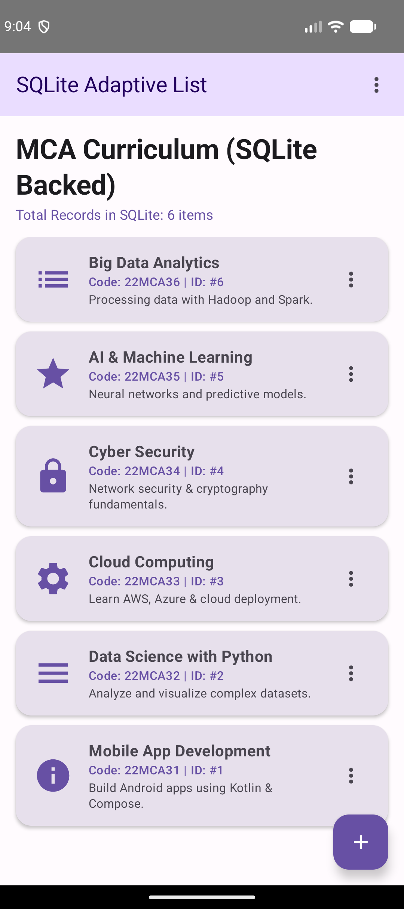
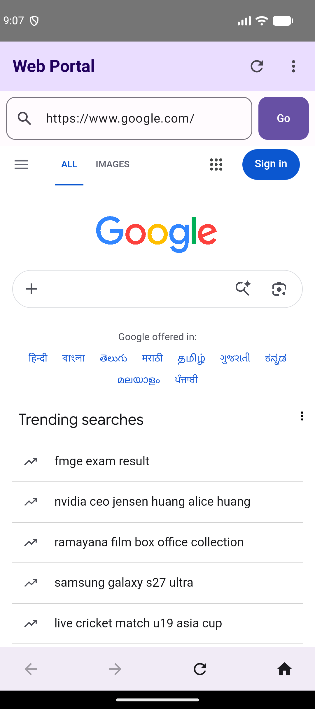

# Experiment 10: Data Sharing in Android using Contacts ContentProvider

## Description
This experiment demonstrates **Data Sharing and Access** in Android using the system **Contacts ContentProvider** (`ContactsContract`). Building upon the data persistence mechanisms (SharedPreferences and SQLite) implemented in Experiment 9, this application showcases how Android components share structured data securely via `ContentResolver` queries, runtime permissions, and system share intents.

## Concept & Technology
- **Android Studio & Kotlin**: Development platform and modern language for Android apps.
- **ContentProvider & ContentResolver**: `context.contentResolver.query(ContactsContract.CommonDataKinds.Phone.CONTENT_URI, ...)` queries device contacts securely through Android's standardized Data Access Layer.
- **ContactsContract API**: Android's system framework contract defining URI schemes and column mappings (`DISPLAY_NAME`, `NUMBER`) for contacts.
- **Runtime Permissions**: `READ_CONTACTS` permission requested dynamically using `ActivityResultContracts.RequestPermission()`.
- **Explicit Data Sharing (`Intent.ACTION_SEND`)**: Triggers system share chooser (`Intent.createChooser`) to share contact information externally with other Android applications.
- **SharedPreferences & SQLite Persistence**: Inherited from Experiment 9 for user session management and `MCA_Courses.db` course storage.
- **Embedded WebView & Options Menus**: Web portal rendering and TopAppBar dropdown menus inherited from Experiments 8 & 9.

## Scenario
1. **Contacts ContentProvider Access**:
   - The user opens `ContactsActivity` to view system contacts.
   - The app checks for `READ_CONTACTS` runtime permission and requests it if missing.
   - Using `ContentResolver`, contacts are queried from `ContactsContract.CommonDataKinds.Phone.CONTENT_URI` and rendered in a search-filterable list.
   - Fallback department contacts are provided when testing on fresh emulators or before permission grant.
2. **Contact Data Sharing**:
   - Tapping the options menu on any contact item displays "Share Contact Details".
   - Selecting share constructs an `Intent(Intent.ACTION_SEND)` containing formatted contact details (Name, Phone, Email) and opens the native Android Share Sheet.
3. **Integrated Application Ecosystem**:
   - Unified Dashboard displays real-time status cards for Contacts ContentProvider, SharedPreferences Storage, and SQLite Database record counts.

## Project Structure
```text
Exp-10/
├── app/
│   ├── src/
│   │   ├── main/
│   │   │   ├── java/com/example/contentproviderapp/
│   │   │   │   ├── AccountActivity.kt (Account & System Overview)
│   │   │   │   ├── AdaptiveListActivity.kt (SQLite-backed Course List)
│   │   │   │   ├── AppTopBar.kt (Reusable Options Menu Bar)
│   │   │   │   ├── ContactsActivity.kt (ContentProvider Contacts Access & Sharing)
│   │   │   │   ├── ContactsHelper.kt (ContentResolver Query Helper)
│   │   │   │   ├── DashboardActivity.kt (Main Hub & Multi-Storage Status Cards)
│   │   │   │   ├── DatabaseHelper.kt (SQLite Database Helper)
│   │   │   │   ├── HomeActivity.kt (Home Screen)
│   │   │   │   ├── LoginActivity.kt (SharedPreferences Login)
│   │   │   │   ├── NotificationHelper.kt (Notification Manager)
│   │   │   │   ├── PreferencesManager.kt (SharedPreferences Storage Helper)
│   │   │   │   ├── StudentDetailsActivity.kt (Student Profile Screen)
│   │   │   │   └── WebViewActivity.kt (Embedded Web Viewer)
│   │   │   └── AndroidManifest.xml (Manifest with READ_CONTACTS & INTERNET)
│   └── build.gradle.kts (Module Build Script)
├── screenshots/
│   ├── dashboard.png (Dashboard Hub with ContentProvider & Persistence Stats)
│   ├── contacts_list.png (Contacts ContentProvider Screen & Options Menu)
│   ├── sqlite_database.png (SQLite Database Course List)
│   └── webview.png (Embedded WebView Portal)
├── build.gradle.kts (Sub-project Build Script)
└── README.md (Documentation)
```

## Features & Key Functionalities
1. **System ContentProvider Access**: Uses `ContentResolver` to query `ContactsContract` with column projection and sorting.
2. **Runtime Permission Handling**: Dynamic `READ_CONTACTS` permission dialog flow.
3. **External Data Sharing**: Sends formatted contact payloads to external apps using `Intent.ACTION_SEND` and system chooser.
4. **Search Filtering**: Real-time filtering of contact records.
5. **Multi-Storage Hub**: Unified Dashboard showcasing ContentProvider, SharedPreferences, and SQLite DB integration.

## Test Cases & Screenshots

### Test Case 1: Experiment 10 Multi-Storage Dashboard
- **Scenario**: Authenticate and navigate to the Experiment 10 Dashboard.
- **Expected Output**: Displays status cards for Contacts ContentProvider (records available), SharedPreferences Storage, and SQLite Database.
- **Result**: Pass


### Test Case 2: Contacts ContentProvider & Data Sharing
- **Scenario**: Open `ContactsActivity` and tap the 3-dots menu on a contact item.
- **Expected Output**: Contacts queried via `ContentResolver` are displayed. Option menu shows "Share Contact Details (Data Sharing)" to trigger system share intent.
- **Result**: Pass


### Test Case 3: SQLite Database Integration
- **Scenario**: Open the SQLite Course List screen.
- **Expected Output**: Queries and renders course records stored in `MCA_Courses.db`.
- **Result**: Pass


### Test Case 4: Embedded WebView Portal
- **Scenario**: Navigate to Web Portal (WebView).
- **Expected Output**: Web content renders inside the embedded `WebView` with URL controls and navigation.
- **Result**: Pass

