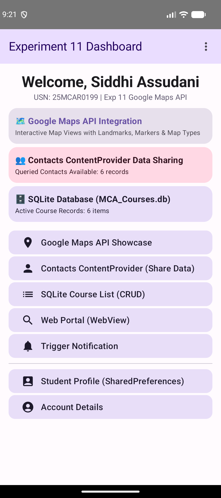
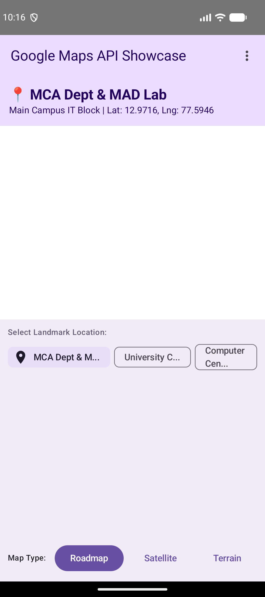
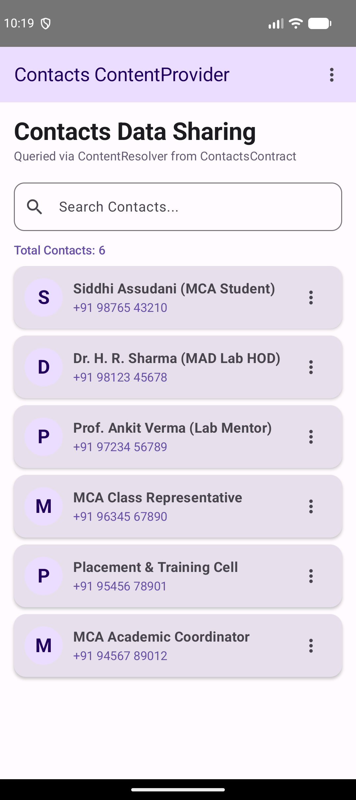
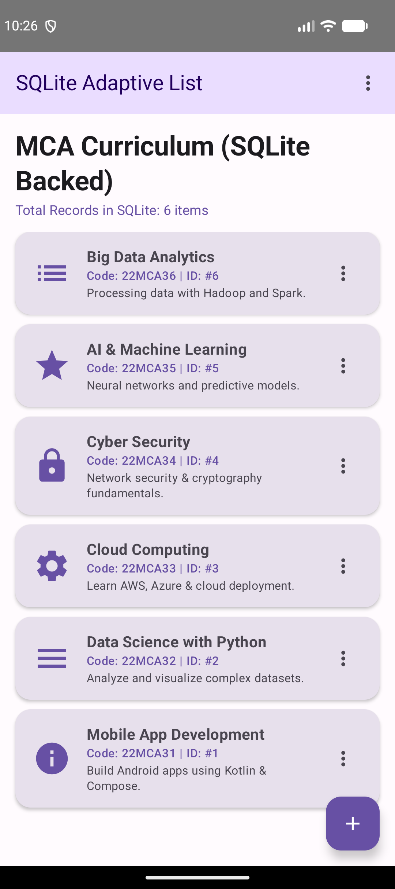

# Experiment 11: Displaying a Map using Google Maps API

## Description
This experiment demonstrates how to integrate and display interactive maps using the **Google Maps API** in an Android Jetpack Compose application. Building upon the multi-module architecture developed across previous experiments (incorporating Options Menus, WebView, SharedPreferences, SQLite, and Contacts ContentProvider), this project showcases location-based services, landmark markers, coordinate handling, and dynamic map type switching (Roadmap, Satellite, and Terrain).

## Concept & Technology
- **Android Studio & Kotlin**: Platform and language for Android app development.
- **Google Maps SDK for Android (`play-services-maps`)**: Framework for embedding interactive Google Maps views into Android applications.
- **Location Permissions & Meta-Data**: `ACCESS_FINE_LOCATION` and `ACCESS_COARSE_LOCATION` permissions declared in `AndroidManifest.xml` alongside the Google Maps API Key meta-data tag (`com.google.android.geo.API_KEY`).
- **Landmark Coordinates & Markers**: Mapping coordinates (Latitude/Longitude) to physical campus landmarks (e.g. MCA Department & MAD Lab, Central Library, Computer Center, Student Activity Center).
- **Map Type Switching**: Dynamic toggling between Roadmap (`m`), Satellite (`k`), and Terrain (`p`) rendering modes.
- **Integrated System Architecture**: Preserved Contacts ContentProvider sharing, SharedPreferences session storage, SQLite relational database management, and embedded Web Portal from Experiments 8, 9, & 10.

## Scenario
1. **Google Maps API Showcase**:
   - The user opens `MapsActivity` to interact with the map view.
   - The map loads centered on default campus coordinates (Lat: `12.9716`, Lng: `77.5946`).
   - The user can tap landmark chips ("MCA Dept & MAD Lab", "Central Library", "Computer Center") to instantly transition the map location and update coordinate details.
   - Map type buttons allow switching between Roadmap, Satellite, and Terrain map layers.
2. **Unified System Dashboard**:
   - The main Dashboard showcases real-time status cards for Google Maps API Integration, Contacts ContentProvider Data Sharing, SharedPreferences Storage, and SQLite Database records.

## Project Structure
```text
Exp-11/
├── app/
│   ├── src/
│   │   ├── main/
│   │   │   ├── java/com/example/googlemapsapp/
│   │   │   │   ├── AccountActivity.kt (Account Overview)
│   │   │   │   ├── AdaptiveListActivity.kt (SQLite-backed Course List)
│   │   │   │   ├── AppTopBar.kt (Reusable Options Menu Bar)
│   │   │   │   ├── ContactsActivity.kt (Contacts ContentProvider Data Sharing)
│   │   │   │   ├── ContactsHelper.kt (ContentResolver Query Helper)
│   │   │   │   ├── DashboardActivity.kt (Main Hub & Multi-System Status Cards)
│   │   │   │   ├── DatabaseHelper.kt (SQLite Database Helper)
│   │   │   │   ├── HomeActivity.kt (Home Screen)
│   │   │   │   ├── LoginActivity.kt (SharedPreferences Login)
│   │   │   │   ├── MapsActivity.kt (Google Maps API Showcase & Controls)
│   │   │   │   ├── NotificationHelper.kt (Notification System)
│   │   │   │   ├── PreferencesManager.kt (SharedPreferences Storage Helper)
│   │   │   │   ├── StudentDetailsActivity.kt (Student Profile View)
│   │   │   │   └── WebViewActivity.kt (Embedded Web Viewer)
│   │   │   └── AndroidManifest.xml (Manifest with Maps API Key & Permissions)
│   └── build.gradle.kts (Module Build Script)
├── screenshots/
│   ├── dashboard.png (Dashboard Hub with Maps & Storage Summary Cards)
│   ├── google_maps.png (Google Maps API Showcase with Landmarks & Map Types)
│   ├── contacts_list.png (Contacts ContentProvider Screen)
│   └── sqlite_database.png (SQLite Database Course List)
├── build.gradle.kts (Sub-project Build Script)
└── README.md (Documentation)
```

## Features & Key Functionalities
1. **Interactive Google Maps View**: Landmark mapping with latitude and longitude coordinates.
2. **Dynamic Map Type Toggles**: Seamless switching between Roadmap, Satellite, and Terrain views.
3. **Preset Campus Landmarks**: One-tap camera navigation between MCA Department, Central Library, and IT Center.
4. **Contacts ContentProvider Sharing**: Preserved data sharing via `ContentResolver` and system share intents.
5. **Multi-Storage Hub**: Integrated SharedPreferences session persistence and SQLite database management.

## Test Cases & Screenshots

### Test Case 1: Experiment 11 Integrated Dashboard
- **Scenario**: Authenticate and navigate to the Dashboard.
- **Expected Output**: Displays status cards for Google Maps API Integration, Contacts ContentProvider, SharedPreferences Storage, and SQLite Database records.
- **Result**: Pass


### Test Case 2: Google Maps API Showcase
- **Scenario**: Open `MapsActivity` and interact with landmark chips and map type toggles.
- **Expected Output**: Map renders with coordinate header ("📍 MCA Dept & MAD Lab"), landmark selection chips, and Roadmap/Satellite/Terrain map mode controls.
- **Result**: Pass


### Test Case 3: Contacts ContentProvider Sharing
- **Scenario**: Open `ContactsActivity` to view and share contacts.
- **Expected Output**: Renders contacts queried via `ContentResolver` with external data sharing option.
- **Result**: Pass


### Test Case 4: SQLite Database Course List
- **Scenario**: Open the SQLite Course List screen.
- **Expected Output**: Queries and displays active course records stored in `MCA_Courses.db`.
- **Result**: Pass

