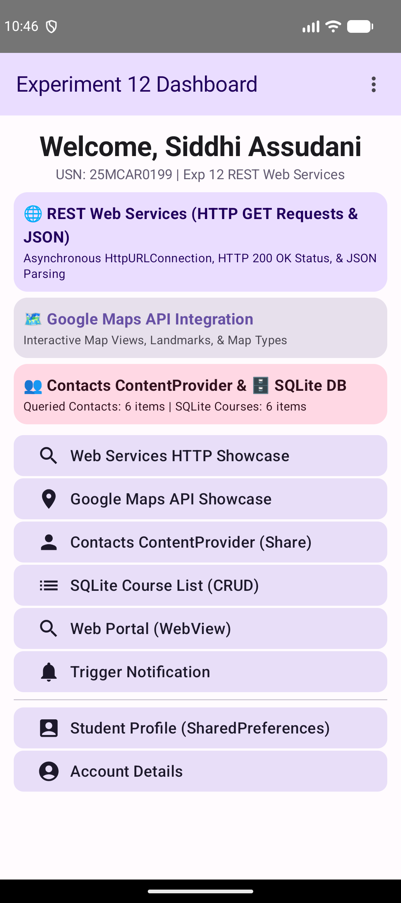
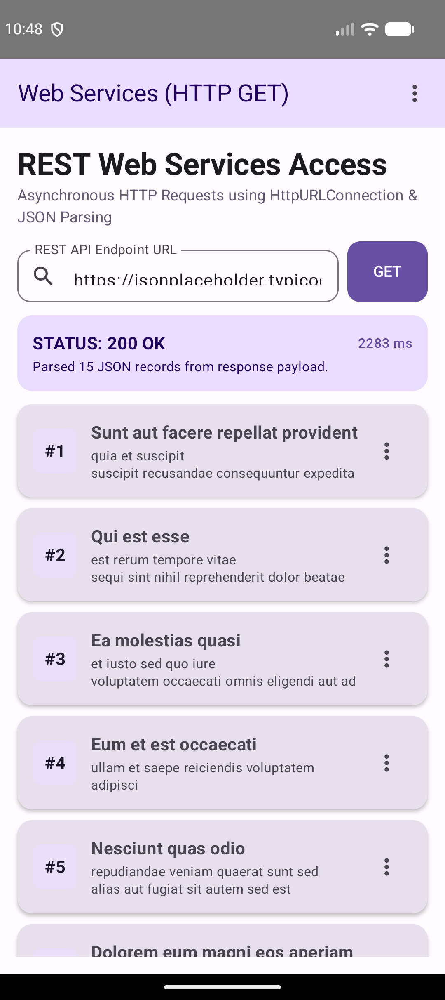
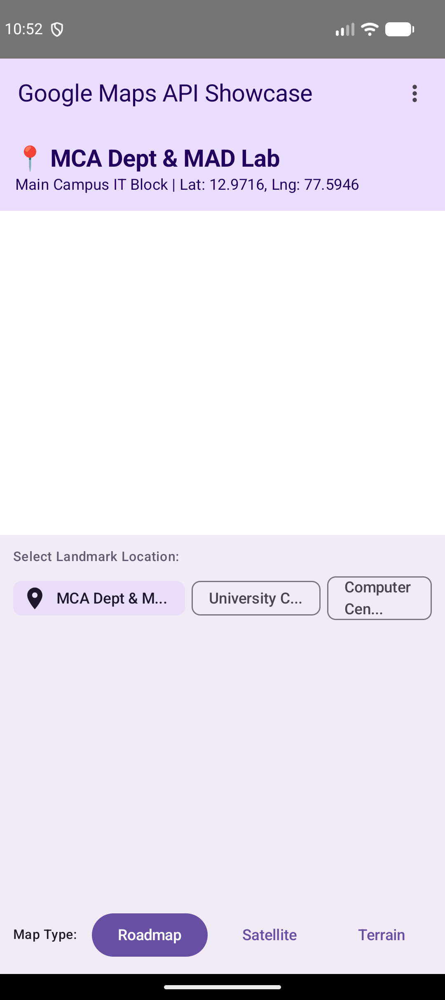
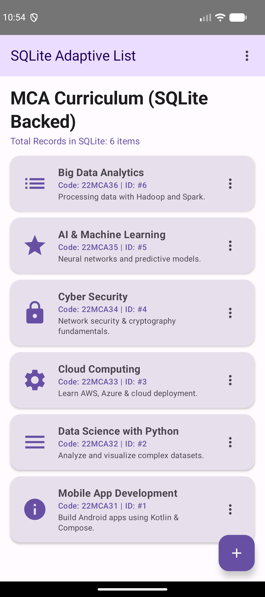

# Experiment 12: Accessing Web Services using HTTP Requests

## Description
This experiment demonstrates how to access, query, and consume remote **RESTful Web Services** using **HTTP Requests** and **JSON Parsing** in an Android Jetpack Compose application. Building upon the comprehensive multi-module architecture developed across previous experiments (combining Google Maps API, Contacts ContentProvider, SharedPreferences, SQLite, and WebView), this project showcases asynchronous network operations using Kotlin Coroutines (`Dispatchers.IO`), `HttpURLConnection`, HTTP status code evaluation (`HTTP 200 OK`), and JSON data parsing.

## Concept & Technology
- **Android Studio & Kotlin**: Development environment and modern language for Android apps.
- **Asynchronous Networking (`HttpURLConnection`)**: Executing asynchronous HTTP GET requests off the main UI thread using Kotlin Coroutines (`withContext(Dispatchers.IO)`).
- **RESTful API Endpoint & HTTP Methods**: Interacting with REST endpoints (`https://jsonplaceholder.typicode.com/posts`) and processing HTTP response headers and status codes (`200 OK`).
- **JSON Payload Parsing (`org.json`)**: Parsing incoming JSON array response buffers using `JSONArray` and `JSONObject` into typed domain models (`WebServiceItem`).
- **Network Permissions & Security**: `INTERNET` and `ACCESS_NETWORK_STATE` permissions with cleartext traffic configurations declared in `AndroidManifest.xml`.
- **Integrated System Architecture**: Preserved Google Maps API (`MapsActivity`), Contacts ContentProvider sharing (`ContactsActivity`), SharedPreferences session storage, SQLite database CRUD (`AdaptiveListActivity`), and embedded WebView (`WebViewActivity`).

## Scenario
1. **REST Web Services HTTP Request & Parsing**:
   - The user opens `WebServiceActivity` to query external web services.
   - Entering a REST API endpoint URL and clicking "GET" triggers an asynchronous HTTP GET request on a background coroutine thread.
   - The app evaluates response headers, calculates response latency (ms), parses the JSON array payload, and updates Compose state.
   - An HTTP Status Card displays response metrics (`STATUS: 200 OK`, response time, and record count).
   - Tapping any REST API record allows sharing the JSON payload or viewing the raw endpoint in the embedded `WebView`.
2. **Unified Architecture Dashboard**:
   - The main Dashboard displays real-time status cards for Web Services (HTTP GET), Google Maps API, Contacts ContentProvider, SharedPreferences Storage, and SQLite Database records.

## Project Structure
```text
Exp-12/
├── app/
│   ├── src/
│   │   ├── main/
│   │   │   ├── java/com/example/webservicesapp/
│   │   │   │   ├── AccountActivity.kt (Account Overview)
│   │   │   │   ├── AdaptiveListActivity.kt (SQLite-backed Course List)
│   │   │   │   ├── AppTopBar.kt (Reusable Options Menu Bar)
│   │   │   │   ├── ContactsActivity.kt (Contacts ContentProvider Sharing)
│   │   │   │   ├── ContactsHelper.kt (ContentResolver Query Helper)
│   │   │   │   ├── DashboardActivity.kt (Main Hub & Multi-Service Summary Cards)
│   │   │   │   ├── DatabaseHelper.kt (SQLite Database Helper)
│   │   │   │   ├── HomeActivity.kt (Home Screen)
│   │   │   │   ├── HttpWebServiceHelper.kt (Asynchronous HTTP Request & JSON Parser)
│   │   │   │   ├── LoginActivity.kt (SharedPreferences Login)
│   │   │   │   ├── MapsActivity.kt (Google Maps API Showcase)
│   │   │   │   ├── NotificationHelper.kt (Notification System)
│   │   │   │   ├── PreferencesManager.kt (SharedPreferences Helper)
│   │   │   │   ├── StudentDetailsActivity.kt (Student Profile View)
│   │   │   │   ├── WebServiceActivity.kt (HTTP Requests & REST Web Service Showcase)
│   │   │   │   └── WebViewActivity.kt (Embedded Web Viewer)
│   │   │   └── AndroidManifest.xml (Manifest Declarations & Network Permissions)
│   └── build.gradle.kts (Module Build Script)
├── screenshots/
│   ├── dashboard.png (Dashboard Hub showcasing Web Services & All Modules)
│   ├── web_services.png (Web Services HTTP GET Showcase with 200 OK Status)
│   ├── google_maps.png (Google Maps API Showcase)
│   └── sqlite_database.png (SQLite Database Course List)
├── build.gradle.kts (Sub-project Build Script)
└── README.md (Documentation)
```

## Features & Key Functionalities
1. **Asynchronous HTTP Requests**: Off-thread network execution using Kotlin Coroutines (`Dispatchers.IO`) and `HttpURLConnection`.
2. **JSON Parsing & Data Mapping**: Real-time parsing of JSON array response buffers.
3. **HTTP Status & Metrics Display**: Live status cards showing HTTP Response Code (`200 OK`), server message, and latency statistics.
4. **External Web Service Integration**: RESTful API communication with optional endpoint customization.
5. **Multi-Module System Synergy**: Full integration of Google Maps, ContentProvider contacts, SharedPreferences session storage, and SQLite database persistence.

## Test Cases & Screenshots

### Test Case 1: Experiment 12 Integrated Dashboard
- **Scenario**: Authenticate and open the Dashboard.
- **Expected Output**: Displays live status cards for REST Web Services (HTTP GET), Google Maps API, Contacts ContentProvider, SharedPreferences Storage, and SQLite Database.
- **Result**: Pass


### Test Case 2: Web Services HTTP Requests & JSON Parsing
- **Scenario**: Open `WebServiceActivity` and tap "GET" to request data from the REST web service endpoint (`https://jsonplaceholder.typicode.com/posts`).
- **Expected Output**: Asynchronous HTTP request completes, status card displays `STATUS: 200 OK` with latency, and parsed JSON records are rendered in a scrollable list.
- **Result**: Pass


### Test Case 3: Google Maps API Integration
- **Scenario**: Launch `MapsActivity` from the dashboard or options menu.
- **Expected Output**: Interactive Google Map renders landmark coordinates with Roadmap, Satellite, and Terrain controls.
- **Result**: Pass


### Test Case 4: SQLite Database Course Management
- **Scenario**: Open the SQLite Course List screen.
- **Expected Output**: Queries and displays active course records stored in `MCA_Courses.db`.
- **Result**: Pass

