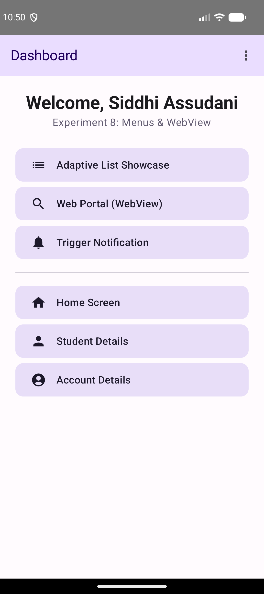
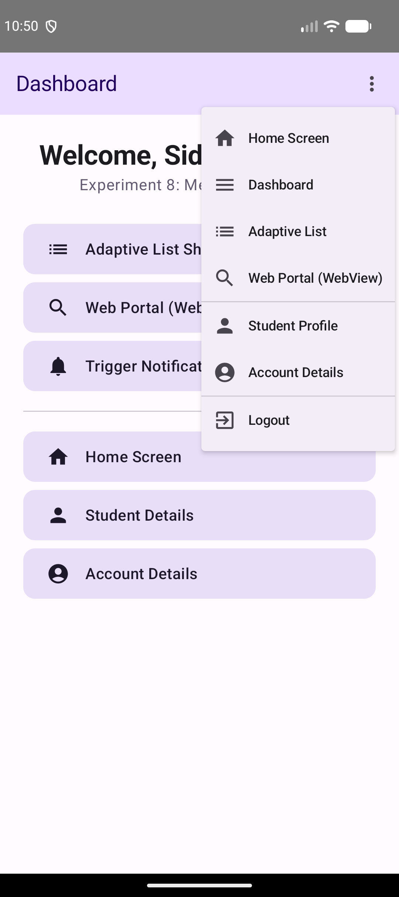
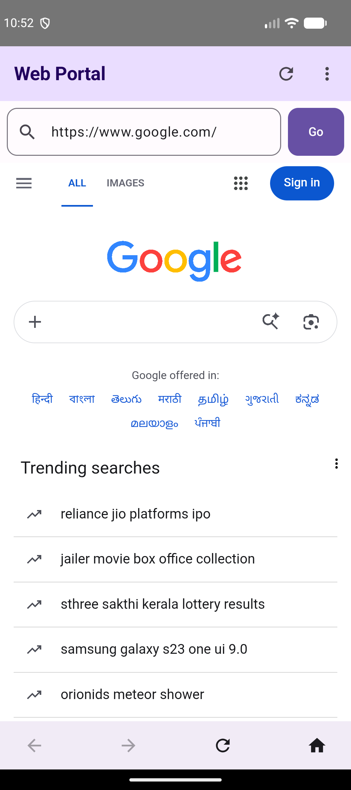
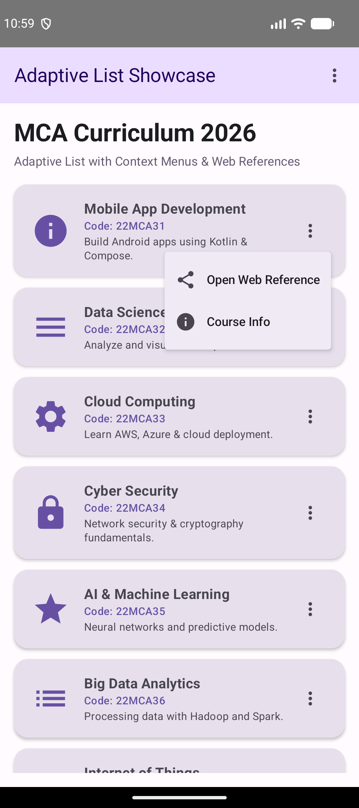

# Experiment 8: Implementing Menus and WebView in an Android Application

## Description
This experiment focuses on implementing **Options Menus**, **Context Popup Menus**, and an embedded **WebView** within an Android Jetpack Compose application. Building upon the multi-screen adaptive architecture developed in Experiment 7, this project introduces structured navigation via app bar menus and dynamic web page rendering using Android's native `WebView` component wrapped inside Jetpack Compose `AndroidView`.

## Concept & Technology
- **Android Studio & Kotlin**: Core IDE and programming language for modern Android development.
- **Jetpack Compose UI**: Declarative UI toolkit used across all screens.
- **TopAppBar & DropdownMenu (Options Menu)**: App bar with action icons and overflow menus providing application-wide quick navigation across screens.
- **Context / Item Popup Menus**: Dropdown menus attached to specific UI items (e.g. course cards) allowing contextual actions like opening external web references.
- **WebView & AndroidView**: `AndroidView` interop wrapping `android.webkit.WebView` to render web content directly within the application.
- **WebChromeClient & WebViewClient**: Handles page loading progress tracking, custom URL routing, and browser history (Back/Forward controls).
- **INTERNET Permission**: Declarative `android.permission.INTERNET` added in `AndroidManifest.xml`.
- **Adaptive Layout**: Responsive layouts with `BoxWithConstraints` and `LazyColumn` inherited from Experiment 7.

## Scenario
The application extends the MCA Student Portal with two key capabilities:
1. **Global App Menus**: An Options Menu present in the top app bar of every activity (`AppTopBar`), offering instant navigation between Home, Dashboard, Adaptive List, Web Portal, Student Details, Account, and Logout.
2. **Interactive Web Portal (WebView)**: A full-featured web viewer activity featuring:
   - URL address input bar with a "Go" button.
   - Progress bar indicating web page loading status (`WebChromeClient`).
   - Preset web link selections (Google, Wikipedia, Kotlin Docs, Android Developers).
   - Bottom web control bar (Back, Forward, Reload, Home).
   - Contextual web link triggers directly from course cards in the Adaptive Curriculum List.

## Project Structure
```text
Exp-8/
├── app/
│   ├── src/
│   │   ├── main/
│   │   │   ├── java/com/example/menuwebviewapp/
│   │   │   │   ├── AccountActivity.kt (Account Screen with Top Bar Menu)
│   │   │   │   ├── AdaptiveListActivity.kt (Adaptive List with Context Menus)
│   │   │   │   ├── AppTopBar.kt (Reusable TopAppBar with Options Menu)
│   │   │   │   ├── DashboardActivity.kt (Main Hub & Navigation)
│   │   │   │   ├── HomeActivity.kt (Home Screen)
│   │   │   │   ├── LoginActivity.kt (Authentication Screen)
│   │   │   │   ├── NotificationHelper.kt (Notification Manager)
│   │   │   │   ├── StudentDetailsActivity.kt (Student Profile View)
│   │   │   │   └── WebViewActivity.kt (Embedded WebView Portal)
│   │   │   └── AndroidManifest.xml (Manifest with INTERNET Permission)
│   └── build.gradle.kts (Module Build Script)
├── screenshots/
│   ├── dashboard.png (Main Dashboard Screen)
│   ├── options_menu.png (TopAppBar Options Dropdown Menu)
│   ├── webview.png (Embedded WebView Web Portal)
│   └── list.png (Adaptive List with Course Context Menu)
├── build.gradle.kts (Sub-project Build Script)
└── README.md (Documentation)
```

## Features & Scenarios
1. **Options Menu Navigation**: Quick access dropdown menu embedded in `TopAppBar` across all app screens.
2. **Contextual Course Web Links**: Tapping the context menu on any MCA course card opens `WebViewActivity` with web references.
3. **Full-Featured Embedded Browser**: JavaScript-enabled `WebView` with custom loading progress indicator, URL text field, and history controls.
4. **Adaptive UI Persistence**: Maintained list optimization (`LazyColumn`) and adaptive layout structure from Experiment 7.

## Test Cases & Screenshots

### Test Case 1: Dashboard Hub
- **Scenario**: Launch the app and authenticate to open the main Dashboard.
- **Expected Output**: Shows welcome banner ("Welcome, Siddhi Assudani"), experiment details, and quick action navigation buttons.
- **Result**: Pass


### Test Case 2: Options Menu Navigation
- **Scenario**: Tap the 3-dots Options Menu icon in the top app bar on the Dashboard or any activity.
- **Expected Output**: Dropdown menu opens showing quick navigation links to Home, Dashboard, Adaptive List, Web Portal, Student Profile, Account, and Logout.
- **Result**: Pass


### Test Case 3: Embedded WebView Web Portal
- **Scenario**: Open Web Portal (WebView) and load a webpage (e.g. `https://www.google.com`).
- **Expected Output**: Web content renders inside the app's `WebView` with URL address bar, web chrome client progress bar, and bottom navigation controls.
- **Result**: Pass


### Test Case 4: Adaptive List & Course Context Menu
- **Scenario**: Open the Adaptive List Showcase and tap the 3-dots menu icon on a course card (e.g. "Mobile App Development").
- **Expected Output**: Course context popup menu displays "Open Web Reference" and "Course Info". Selecting "Open Web Reference" launches `WebViewActivity`.
- **Result**: Pass

