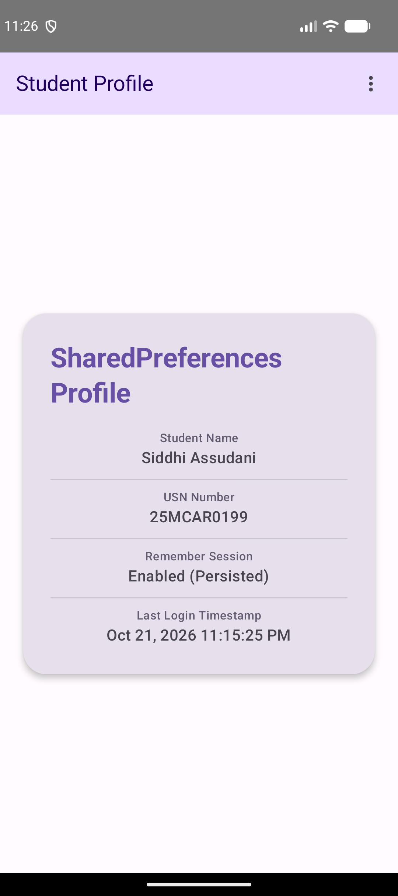
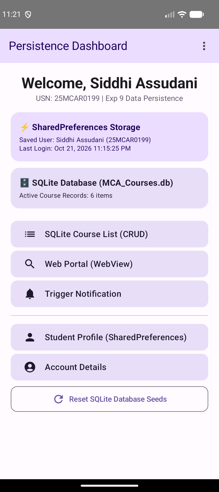
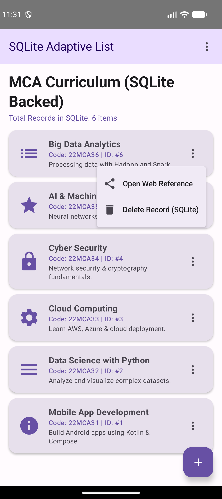
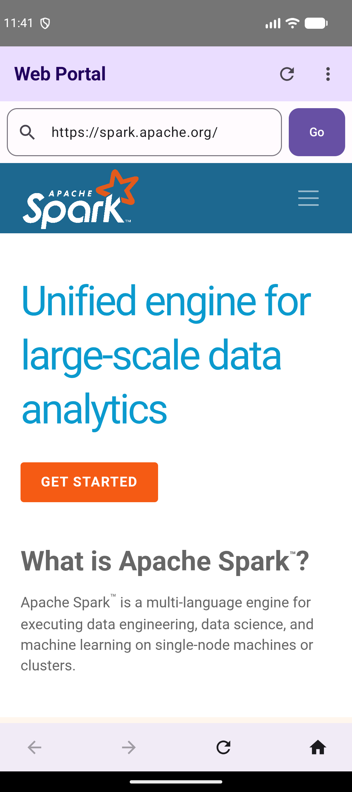

# Experiment 9: Data Persistence using SharedPreferences and SQLite Database

## Description
This experiment demonstrates **Data Persistence** mechanisms in Android using two primary techniques:
1. **SharedPreferences**: Storing key-value pairs for lightweight user session data, login preferences, and application settings.
2. **SQLite Relational Database**: Using `SQLiteOpenHelper` for structured, relational database management to support full **CRUD** (Create, Read, Update, Delete) operations.

Building upon the multi-screen, menu-driven architecture of Experiment 8, this project shows how to retain user credentials across sessions and dynamically manage an MCA course database (`MCA_Courses.db`) with real-time UI updates in Jetpack Compose.

## Concept & Technology
- **Android Studio & Kotlin**: Platform and modern language for Android development.
- **SharedPreferences (`PreferencesManager`)**: Key-value store used to persist user credentials, "Remember Me" preferences, and last login timestamps across application restarts.
- **SQLite Database (`DatabaseHelper` & `SQLiteOpenHelper`)**: Embedded relational database engine used to manage structured data (`courses` table) with full CRUD SQL execution (`insert`, `rawQuery`, `update`, `delete`).
- **Jetpack Compose UI & State Management**: Reactive UI rendering lists dynamically from SQLite queries with state updates.
- **WebView Interop**: Renders reference web links stored in the SQLite database directly inside an embedded `WebView`.
- **TopAppBar & DropdownMenu Options Menu**: App bar navigation preserved from Experiment 8 for quick screen transitions.

## Scenario
1. **SharedPreferences Session Persistence**:
   - On `LoginActivity`, the user can check "Remember Me". Credentials and login timestamp are saved to `SharedPreferences`.
   - Subsequent launches automatically pre-fill user credentials from `SharedPreferences`.
   - `StudentDetailsActivity` displays persisted profile details stored in key-value format.
2. **SQLite Database Management (CRUD)**:
   - On `AdaptiveListActivity`, courses are dynamically queried from `MCA_Courses.db`.
   - Users can add new courses via a Floating Action Button (`+`) dialog, inserting records into SQLite.
   - Item context menus allow deleting individual rows from SQLite or launching `WebViewActivity` using reference URLs retrieved from the database.
   - The Dashboard shows live statistics of active records in the SQLite database and includes a "Reset Seeds" option.

## Project Structure
```text
Exp-9/
├── app/
│   ├── src/
│   │   ├── main/
│   │   │   ├── java/com/example/datapersistenceapp/
│   │   │   │   ├── AccountActivity.kt (Account & Persistence Overview)
│   │   │   │   ├── AdaptiveListActivity.kt (SQLite-backed Course List & CRUD Dialogs)
│   │   │   │   ├── AppTopBar.kt (Reusable Options Menu Bar)
│   │   │   │   ├── DashboardActivity.kt (Main Hub & Storage Summary Cards)
│   │   │   │   ├── DatabaseHelper.kt (SQLiteOpenHelper CRUD Operations)
│   │   │   │   ├── HomeActivity.kt (Home Screen)
│   │   │   │   ├── LoginActivity.kt (SharedPreferences Session Login)
│   │   │   │   ├── NotificationHelper.kt (Notification System)
│   │   │   │   ├── PreferencesManager.kt (SharedPreferences Key-Value Helper)
│   │   │   │   ├── StudentDetailsActivity.kt (SharedPreferences Profile Display)
│   │   │   │   └── WebViewActivity.kt (Embedded Web Viewer)
│   │   │   └── AndroidManifest.xml (Manifest Declarations)
│   └── build.gradle.kts (Module Build Script)
├── screenshots/
│   ├── shared_prefs.png (SharedPreferences Profile & Credentials)
│   ├── dashboard.png (Persistence Dashboard with Live Storage Stats)
│   ├── sqlite_database.png (SQLite Database Course List & Context Options)
│   └── webview.png (WebView Portal Rendering Database Link)
├── build.gradle.kts (Sub-project Build Script)
└── README.md (Documentation)
```

## Features & Key Functionalities
1. **Key-Value Persistence (SharedPreferences)**: Automatic session restoration, login pre-fill, and timestamp logging.
2. **Relational Data Persistence (SQLite)**: Custom `SQLiteOpenHelper` managing `courses` table with live querying and row deletion/insertion.
3. **Dynamic UI Synchronization**: Adding or removing SQLite database records immediately updates Jetpack Compose state.
4. **WebView Web Integration**: Seamless transition from SQLite course web links to an embedded `WebView`.
5. **App Bar Options Menu**: Retained from Experiment 8 for navigation.

## Test Cases & Screenshots

### Test Case 1: SharedPreferences Session & Profile Persistence
- **Scenario**: Login with "Remember Me" checked and view the Student Profile screen.
- **Expected Output**: Credentials and timestamp are saved in `SharedPreferences` and restored on `StudentDetailsActivity`.
- **Result**: Pass


### Test Case 2: Persistence Dashboard Overview
- **Scenario**: Open the Dashboard hub to inspect storage status.
- **Expected Output**: Displays live summary cards for SharedPreferences Storage and SQLite Database active record counts.
- **Result**: Pass


### Test Case 3: SQLite Database CRUD Operations
- **Scenario**: Open the Adaptive List screen backed by SQLite and tap the item context menu.
- **Expected Output**: List queries records directly from `MCA_Courses.db`. Context menu displays "Delete Record (SQLite)" and "Open Web Reference".
- **Result**: Pass


### Test Case 4: Embedded WebView with Database Link
- **Scenario**: Select "Open Web Reference" on a course item stored in SQLite (e.g. "Big Data Analytics").
- **Expected Output**: Opens `WebViewActivity` loading the URL (`https://spark.apache.org/`) retrieved from the SQLite record.
- **Result**: Pass

